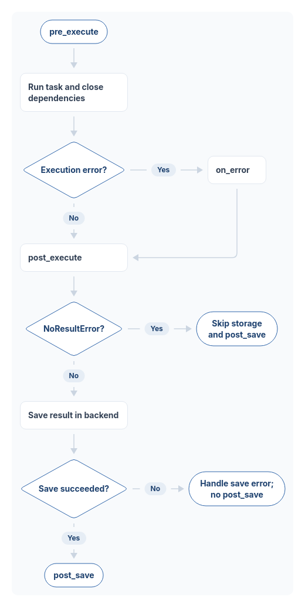

# Middlewares

Middlewares are super helpful. You can inject some code before or after task's execution.

Middlewares must implement [`taskiq.abc.middleware.TaskiqMiddleware`](https://github.com/taskiq-python/taskiq/blob/master/taskiq/abc/middleware.py) abstract class.
Every method of a middleware can be either sync or async. Taskiq will execute it
as you expect.

For example:

::: tabs

@tab sync

@[code python](../examples/extending/middleware_sync.py)

@tab async

@[code python](../examples/extending/middleware_async.py)

:::

Also, middlewares always have a reference to the current broker in `self.broker` field.
If you want to kick a message during the execution of some middleware hooks, you
may use `self.broker` to do so.

[Taskiq-pipelines](https://github.com/taskiq-python/taskiq-pipelines) uses middlewares to
call next tasks.

## Worker hook flow

Worker hooks run after the message has been decoded and its task has been found.
The diagram shows one execution, assuming that the middleware hooks themselves
complete normally:

*Worker middleware flow. [Editable SVG](../assets/worker-middleware-flow.svg).
[Edit diagram](https://svgdiagram.ai/diagram-sources/taskiq-worker-middleware-flow?version=1).*

1. `pre_execute` can modify the message before the task runs.
2. Task execution and dependency cleanup produce the result. If an execution
   error was found, `on_error` runs before `post_execute`.
3. `post_execute` runs for both successful and failed task results.
4. A result containing `NoResultError` skips result storage and `post_save`.
   Other results, including ordinary task errors, are passed to the result backend.
5. `post_save` runs only after the backend saves the result successfully. A save
   error skips `post_save`; it is logged, and can also be propagated by the receiver.

With multiple registered middlewares, `pre_execute` runs in registration order.
`on_error`, `post_execute`, and `post_save` run in reverse registration order.
These worker hooks are separate from the client-side `pre_send` and `post_send`
hooks. Exceptions raised by middleware hooks can interrupt this flow, so handle
them inside the middleware as described in the
[architecture overview](../guide/architecture-overview.md#middlewares).
